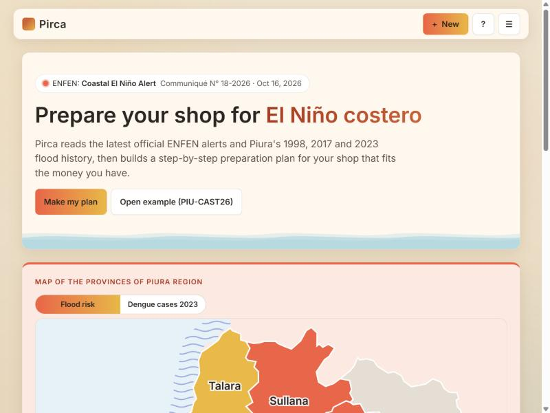

# Pirca

**Pirca helps small shop owners in Piura, Peru, prepare their business for El Niño costero with a short form and a
plan that fits the money they have.**

> Pirca is not an official forecast and not a government agency. It never gives evacuation orders: follow ENFEN,
> SENAMHI, INDECI and your municipality.



MGT 409 (AI Foundations for Managers) final project. Four AI agents read the latest ENFEN alert and Piura's flood
history from 1997-98, 2017 and 2023; code computes every number and checks every plan before the owner sees it.

---

## Requirements

- **Python 3.12 or newer** (Pirca is tested with Python 3.14). Nothing else: no Node, no database.
- For **new** plans only: a Portkey API key (`PORTKEY_API_KEY`). The example plans, the replay and the form's risk
  gauge work without one.

Check your Python:

| Windows (PowerShell) | macOS (Terminal) |
|---|---|
| `py --version` | `python3 --version` |

If it is missing or older than 3.12, install it from [python.org](https://www.python.org/downloads/). On Windows, the
installer's `py` launcher is enough.

## 1. Get the code

```
git clone <repository-url> pirca
cd pirca
```

If you received a .zip instead, unzip it and open PowerShell or Terminal in the folder that contains this README.
Every command below runs from that folder.

## 2. Create the virtual environment and install

**Windows (PowerShell)**

```powershell
py -m venv .venv
.venv\Scripts\python -m pip install -r requirements.txt
```

**macOS (Terminal)**

```bash
python3 -m venv .venv
.venv/bin/python -m pip install -r requirements.txt
```

The commands call the environment's Python directly, so you never need to "activate" it.

## 3. Add the API key (only needed for new plans)

Pirca reads `PORTKEY_API_KEY` from a `.env` file. It needs nothing else: the model (`gpt-6-luna`, through Portkey) is
set in `backend/config.py`. Use **one** of these options:

**Option A: a `.env` in the project folder.** Copy the template, then open it and paste your key after the `=`.

| Windows (PowerShell) | macOS (Terminal) |
|---|---|
| `Copy-Item .env.example .env` then `notepad .env` | `cp .env.example .env` then `open -e .env` |

```
PORTKEY_API_KEY=your-key-here
```

**Option B: a `.env` one folder above the project.** If you already have a `.env` with `PORTKEY_API_KEY` in the
folder that contains `pirca`, Pirca finds it there. If both exist, the project's own `.env` wins.

Never commit `.env` (it is in `.gitignore`).

Optional check (one tiny paid call, a fraction of a cent):

| Windows | macOS |
|---|---|
| `.venv\Scripts\python -m backend.check_llm` | `.venv/bin/python -m backend.check_llm` |

It prints `OK  model=gpt-6-luna …` when the key works.

## 4. Start Pirca

| Windows (PowerShell) | macOS (Terminal) |
|---|---|
| `.venv\Scripts\python -m uvicorn backend.main:app --port 8020` | `.venv/bin/python -m uvicorn backend.main:app --port 8020` |

Wait for `Uvicorn running on http://127.0.0.1:8020`, then open **http://localhost:8020** in your browser.
Stop the server with **Ctrl+C**.

Pirca opens in **English**; switch to Spanish in the **☰** menu (below). Button names in this README are given in
English, with the Spanish label in brackets.

## 5. Quick look (0 tokens, no key needed)

**The six example plans** are saved in `plans/examples/` and open instantly, with no model call:

| Code | Shop | Language of the run |
|---|---|---|
| **PIU-CAST26** | bodega · Castilla (main example) | Spanish |
| PIU-CASTEN | bodega · Castilla | English |
| PIU-FARMES | botica · Piura | Spanish |
| PIU-FARMEN | botica · Piura | English |
| PIU-FERRES | ferretería · Sullana | Spanish |
| PIU-FERREN | ferretería · Sullana | English |

- **Open one:** the start page's **Open example (PIU-CAST26)** button [*Ver ejemplo*] opens the main example. For
  any code, open the **☰** menu, type it under **Open a plan by code** [*Abrir un plan con su código*] and press
  **Open** [*Abrir*].
- **Switch language and currency:** **☰** → **Language** [*Idioma*]: English / Español, and **Currency** [*Moneda*]:
  S/ Soles / $ USD. Every plan is saved in both languages, so switching never calls the model.
- **Watch the agents:** on a plan, press **Replay trace** [*Ver cómo se hizo*]. The live agent map replays the saved
  run: which agent works, each tool it calls, the code checks, and the tokens and cost as they add up.
- **Province map:** on the start page, switch between **Flood risk** [*Riesgo de inundación*] and **Dengue cases 2023**
  [*Casos de dengue 2023*], and tap a province to see its districts. **Make my plan for …** [*Hacer mi plan para …*]
  starts the form with that district chosen.
- **Read aloud:** on a plan, **Listen to the plan** [*Escuchar el plan*] reads it with your browser's voices. It works
  best in **Chrome or Edge**, which include Spanish voices; the button is hidden if the browser has no voice for the
  plan's language.

## 6. Make a new plan (needs the key)

1. Press **+ New** [*+ Nuevo*], or **Make my plan** [*Hacer mi plan*] on the start page.
2. Answer the **5 steps**: Your business, Your stock, Your money, Your suppliers and Your preparation [*Tu negocio,
   Tu mercadería, Tu dinero, Tus proveedores, Tu preparación*]. The risk gauge on the right updates as you answer; it
   is computed by code and costs 0 tokens.
   To skip typing, press **Fill with a sample shop** [*Llenar con un negocio de ejemplo*]: it fills the form for that
   visit only and jumps to the review screen.
3. Press **Make my plan** [*Hacer mi plan*]. The agent map shows the run live.

A plan takes **about 1–3 minutes** (the longest example run took about 2 minutes) and costs **about $0.018** in model
tokens (average $0.0180 per agent run, $0.0187 with the automatic translation into the other language; see
`output/tokenomics.md`). Each plan gets a code such as `PIU-AB12CD`, is saved in `plans/` (not committed), and can be
reopened by code.

## Tests

| | Windows | macOS | Expected result |
|---|---|---|---|
| **Offline** (no key, no cost) | `.venv\Scripts\python -m pytest` | `.venv/bin/python -m pytest` | `346 passed, 1 skipped, 2 deselected` in about 10 seconds |
| **Live** (needs the key) | `.venv\Scripts\python -m pytest -m live` | `.venv/bin/python -m pytest -m live` | `2 passed, 347 deselected` |

The one skipped test checks quotes against the raw source downloads in `data/raw/`, which are not in the repository
(it runs on the machine that has them). The live tests are the two safety checks that need the real model (prompt injection and the token-budget stop); together
they cost about $0.002 (`output/safety/summary.md`).

---

## What Pirca does

A bodega, botica or ferretería owner answers five short groups of questions. Pirca combines the answers with the
latest ENFEN communiqué and what happened in their district in 1997-98, 2017 and 2023, and writes a plan in plain
Spanish or English: their risk level, what to do now / when an alert comes / during flooding / after, how much stock
to move, the emergency cash they need, which supplier roads were cut before, and which purchases fit their budget.
Every amount comes from code, every fact cites its source, and the plan never asks the owner to spend money they
don't have.

## The four agents

| Agent | Job |
|---|---|
| **Manager** (Coordinador) | Runs the team, writes the final plan with `{placeholders}` instead of numbers, and fixes it if a check fails. |
| **Risk Analyst** | Reads the ENFEN communiqués and Piura's flood history and scores the shop's exposure. |
| **Planner** | Sizes the stock move, the emergency fund and the supplier stock-up, and picks the purchases that fit the budget. |
| **Critic** | Tests the plan against hard situations (early rains, a bridge cut, a week without power, a long closure, a sick worker) and can send it back once. |

The agents decide what to say; tools written in Python compute every number (`backend/tools/`).

## Safety checks

Code, not the model, has the last word:

- **Numbers and sources:** `verify_draft` rejects any typed number and any source ID that doesn't exist; every amount
  is filled in from computed facts.
- **Affordability:** a plan whose purchases and stock-up add up to more than the owner's cash fails.
- **No evacuation orders and no own forecasts:** such sentences fail; pointing to INDECI is allowed.
- **Risk level:** section 1 must state the same risk level the gauge shows.
- **Prompt injection:** instructions hidden in a document are ignored and reported.
- **Limits:** caps on agent runs, tool calls and tokens per run (400,000); a run that hits one stops cleanly.

The six safety tests and their evidence: `output/safety/summary.md`.

## Where the evidence is

| Folder or file | What it shows |
|---|---|
| `output/safety/` | The six safety tests: `summary.md` plus one JSON of evidence per test. |
| `output/tokenomics.md` | Tokens and cost of every example run, translations, and what Pirca would cost at scale. |
| `output/sources.md` | Every number in `data/`, its source, link and status (verified, sourced, illustrative estimate, UNVERIFIED). |
| `output/screenshots/` | Screenshots of the app on desktop and phone, in both languages. |
| `AI_prompts.md` | Every prompt given to the coding assistant while building Pirca. |

## Data sources

All in `data/`, each figure listed with its link in `output/sources.md`. Raw downloads stay in `data/raw/` (not committed).

- **ENFEN** (Comisión Multisectorial ENFEN): the four latest official communiqués, up to N° 18-2026 (16 Oct 2026).
- **INDECI** and other official and press reports: flood and road-cut impacts in Piura in 1997-98, 2017 and 2023.
- **MINSA** (dengue prevention advice) and **DIRESA Piura** (2023 dengue cases by district).
- **Promart** (public web catalog, 24 Oct 2026; screens re-checked 25 Oct 2026): prices of shelves, sacks, boxes,
  screens, breakers, lanterns and backpacks. Insurance from Mapfre / Caja Confianza; cloud backup from a 2023 price.
- **BCRP**: the exchange rate, S/ 3.447 per US$ (interbank sale rate, 22 Oct 2026).
- **Map:** `data/geo/piura_provinces.geojson`, Piura region's 8 provinces, built by `backend/build_piura_geo.py` from
  [pe-atlas 0.0.1](https://www.npmjs.com/package/pe-atlas) (MIT license), a redistribution of Peru's 2022 district
  boundaries published by [GeoGPS Perú](https://www.geogpsperu.com/) from INEI's limits.

## Troubleshooting

| Problem | What to do |
|---|---|
| **"PORTKEY_API_KEY is not set"**, or a new plan stops with an error | Add the key (step 3), then restart the server. `python -m backend.check_llm` confirms it. The examples work without a key. |
| **Port 8020 is in use** (`address already in use`, or `[WinError 10048]` on Windows) | Start on another port, e.g. `--port 8021`, and open http://localhost:8021. Or close the other program: on Windows `Get-NetTCPConnection -LocalPort 8020`, on macOS `lsof -i :8020` shows which one. |
| **Windows: "running scripts is disabled on this system"** when you activate `.venv` | You don't need to activate: use the `.venv\Scripts\python …` commands above. If you want to activate, run `Set-ExecutionPolicy -Scope CurrentUser -ExecutionPolicy RemoteSigned` once, then `.venv\Scripts\Activate.ps1`. |
| **`py` or `python3` not found** | Install Python 3.12+ from python.org (on Windows, keep "Add python.exe to PATH" ticked), then open a new terminal. |
| **The page looks old after an update** | Reload with Ctrl+F5 (Windows) or Cmd+Shift+R (macOS). |
